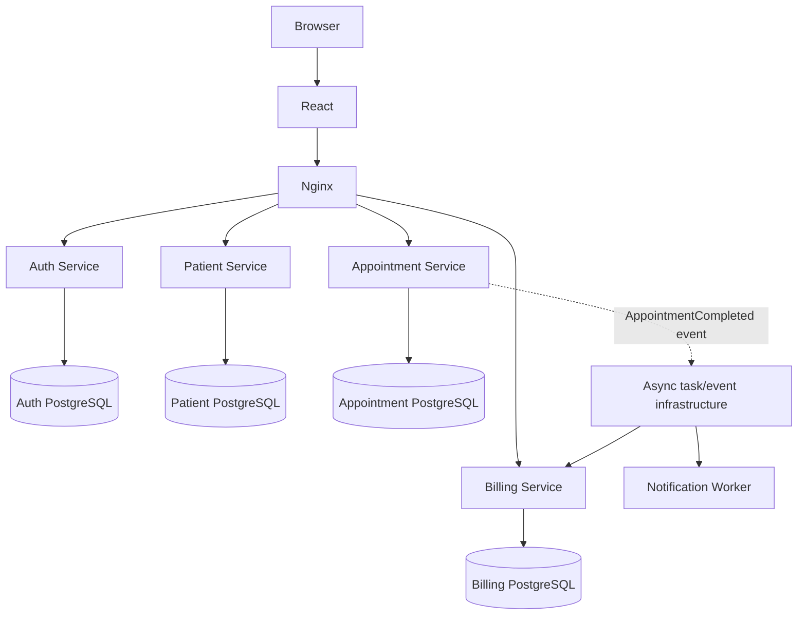

# Hospital Management System Architecture

## Service ownership
- **Auth:** users, roles, account status, token issuance.
- **Patient:** patient profiles and contacts; no passwords.
- **Appointment:** doctors, availability, appointments, and clinical records in the MVP.
- **Billing:** invoices, line items, payments and receipts.
- **Worker:** notifications, retries and background processing.

## Communication
- Synchronous HTTP for user-facing queries and validations.
- Asynchronous events/tasks for notifications and invoice generation after consultation.
- Use a transactional outbox for reliable event publication and idempotent consumers.
- Set timeouts and bounded retries for service calls.

## Data and security
- Each service owns its database; cross-service IDs are UUID references, not cross-database foreign keys.
- Services validate identity and enforce object-level authorization.
- Use synthetic patient data in development.
- Keep secrets out of Git and restrict internal service ports.

## Workflow
Login → register/find patient → select doctor and slot → book appointment → consultation and clinical record → invoice generation → payment → notification.
